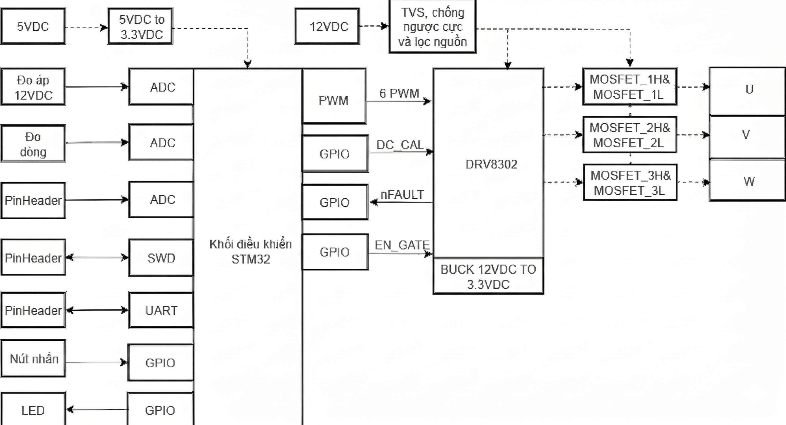
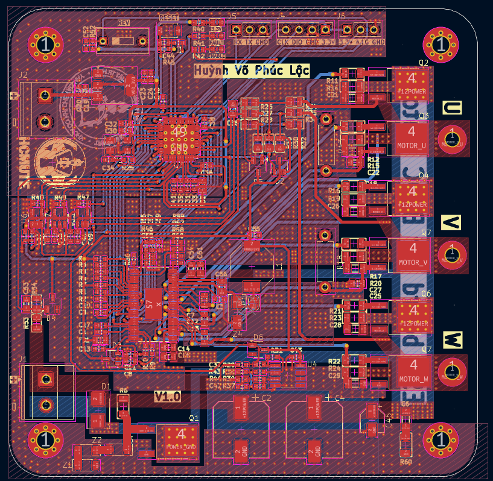
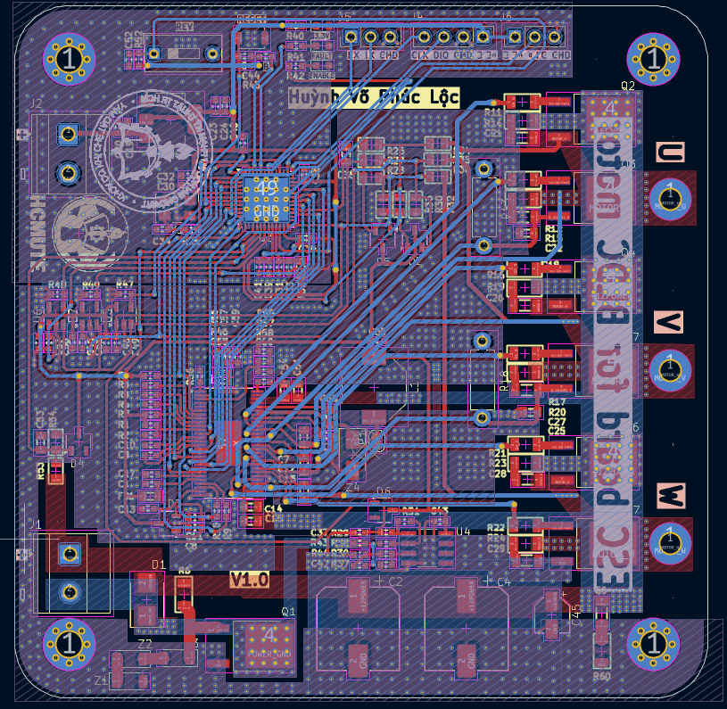
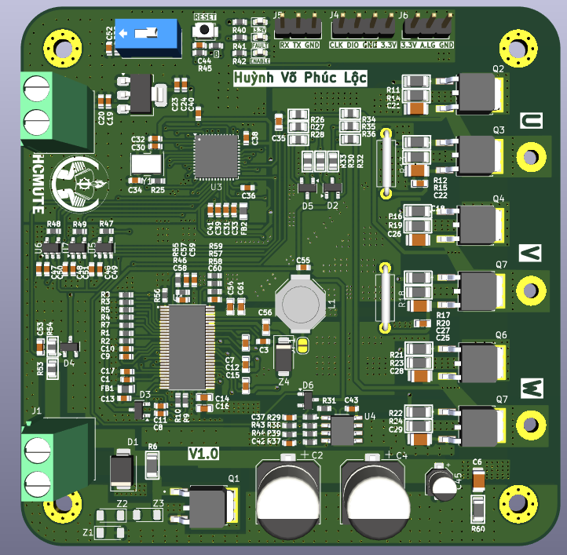
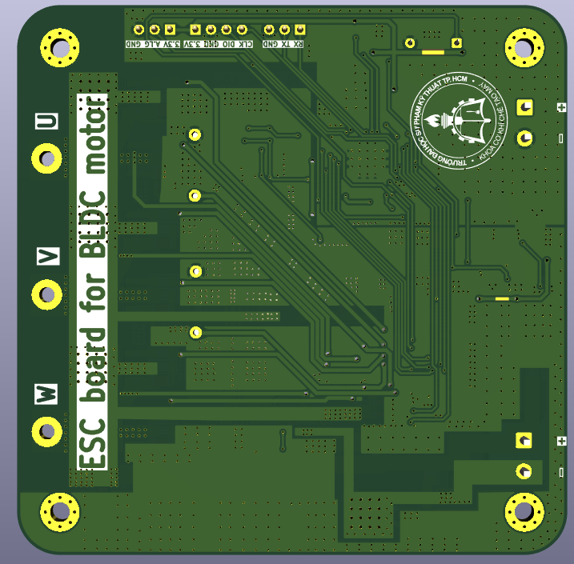

# BLDC Motor Driver (ESC) with DRV8302 and STM32G431

[](https://www.kicad.org/)
[](https://www.st.com/en/microcontrollers-microprocessors/stm32g431cb.html)
[](https://www.ti.com/product/DRV8302)
[]()

**Student:** Huynh Vo Phuc Loc

**Supervisor:** Dr. Bui Ha Duc

---

## Table of Contents

1. [Overview](#overview)
2. [Design Requirements](#design-requirements)
3. [Hardware Design](#hardware-design)
   - [System Architecture](#system-architecture)
   - [Schematic](#schematic)
   - [PCB Layout and Routing](#pcb-layout-and-routing)
4. [Repository Structure](#repository-structure)
5. [Getting Started](#getting-started)
6. [References and Credits](#references-and-credits)
7. [Author](#author)

---

## Overview

This project is an open-source driver board for a three-phase BLDC motor that runs **without Hall sensors**. The target control method is **sensorless six-step (trapezoidal) commutation**.

The design uses two main integrated chips to stay compact:

- **DRV8302** – MOSFET gate driver, two current-sense amplifiers, protection logic and a buck converter.
- **STM32G431CBU6** – generates the PWM signals and reads the phase currents and DC bus voltage.

---

## Design Requirements

The requirements were defined before any part was chosen, and the BOM was then selected to meet them.

### Summary

| Item | Target |
| --- | --- |
| Motor | BLDC U7 V2.0 KV490 (490 RPM/V) or similar |
| Supply | 12 VDC |
| Continuous current | 23 A |
| Control method | Sensorless six-step |
| Board size | 90 × 90 mm |

### Functional requirements

**Power**
- TVS diode and reverse-polarity protection on the DC input
- Bulk capacitors for the DC link
- Clean 3.3 V logic supply, separated from the motor power

**Gate driver and inverter**
- Smart three-phase gate driver with programmable dead-time and over-current protection
- Three-phase inverter built from six low-R<sub>DS(on)</sub>, high-current MOSFETs

**Measurements**
- Two-shunt phase current measurement
- DC bus voltage measurement
- DC input current measurement

**Microcontroller and auxiliaries**
- STM32 motor-control MCU with ADC, UART and SWD
- Push button, slide switch and indicator LEDs
- Analog input header for a future speed command

---

## Hardware Design

### System Architecture



### Schematic

<!-- TODO: add schematic images or a short description of each block
     (power input, DRV8302, inverter, current/voltage sensing, MCU). -->

The full schematic (revision V1.0, 2025-10-22) is in [`Doan2.pdf`](Doan2.pdf).

### PCB Layout and Routing

**Placement.** The board is 90 × 90 mm. The control and analog circuits are grouped at the top-left, and the switching power stage with its bulk capacitors at the bottom-right. Separating them limits electromagnetic interference and crosstalk into the ADC and logic signals. Power paths are kept short to reduce parasitic inductance and voltage spikes on the MOSFETs.

**Trace widths.**

| Net type | Width |
| --- | --- |
| Signals and ADC | 0.3 mm |
| 3.3 V supply | 0.5 mm |
| Gate drive and auxiliary | 0.7 mm |
| Power zones | 8 mm |

**Current capacity.** Using the IPC-2221 formula, an 8 mm outer-layer trace in 1 oz copper carrying 23 A is estimated to rise by about 57 °C (about 87 °C at a 30 °C ambient). This is within the formula's valid range and below the FR-4 glass transition temperature of roughly 130–140 °C.

**Vias.** Many power vias (0.7 mm pad, 0.3 mm drill) share current between layers. Dense thermal vias around the MOSFETs move heat into the other layers.

**Layout**

| Top layer | Bottom layer |
| :---: | :---: |
|  |  |

**3D view**

| Top side | Bottom side |
| :---: | :---: |
|  |  |

---

## Repository Structure

```
BLDC_Motor_Driver_DRV8302/
├── Images/                 # Block diagram, PCB and 3D renders
├── Doan2.kicad_pro         # KiCad project
├── Doan2.kicad_sch         # Schematic (revision V1.0, 2025-10-22)
├── Doan2.kicad_pcb         # PCB layout
├── Doan2.pdf               # Schematic exported to PDF (A1)
├── Doan2.step              # 3D model of the board
├── .gitignore
└── README.md
```

---

## Getting Started

1. Install [KiCad](https://www.kicad.org/download/) 9.0 or newer.
2. Clone the repository:

   ```bash
   git clone https://github.com/Dong-quan/BLDC_Motor_Driver_DRV8302.git
   cd BLDC_Motor_Driver_DRV8302
   ```

3. Open `Doan2.kicad_pro` to view or edit the schematic and PCB.
   - To only read the schematic, open `Doan2.pdf`.
   - For the 3D model, open `Doan2.step` in any CAD viewer.

---

## References and Credits

- **Design reference:** DeepBlueMbedded, [STM32 ESC PCB Design (FOC ESC / BLDC)](https://deepbluembedded.com/stm32-esc-pcb-design-foc-esc-bldc-schematic/).
  This board is adapted from that reference. The component selection, calculations and layout in this repository were done for this project.

---

## Author

- **Huynh Vo Phuc Loc**
- GitHub: [Dong-quan](https://github.com/Dong-quan)
